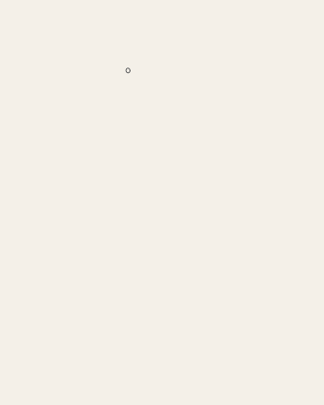
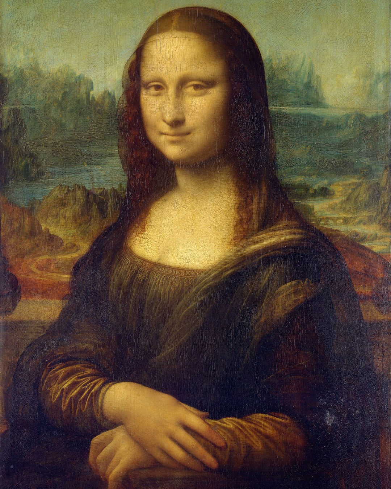
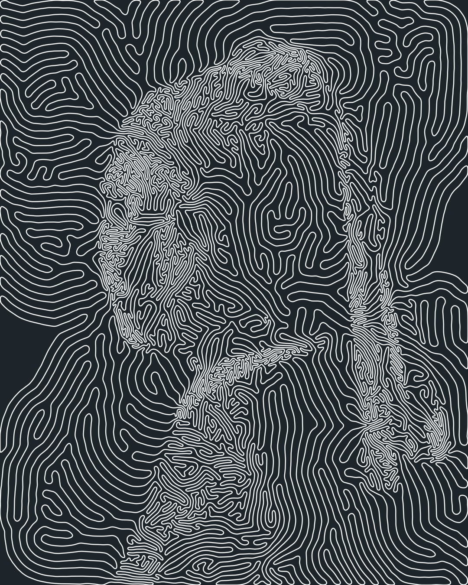
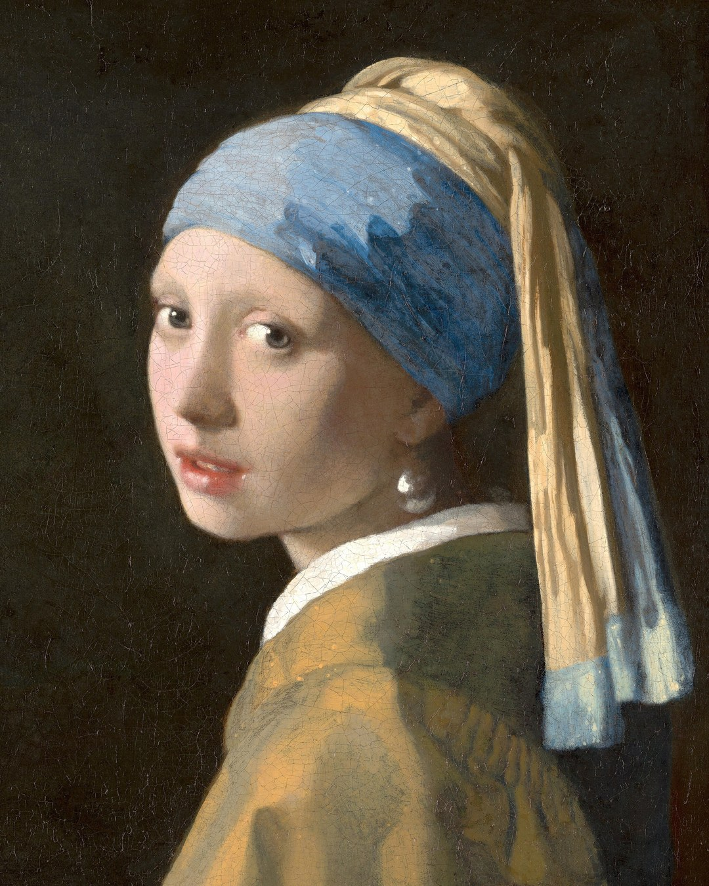
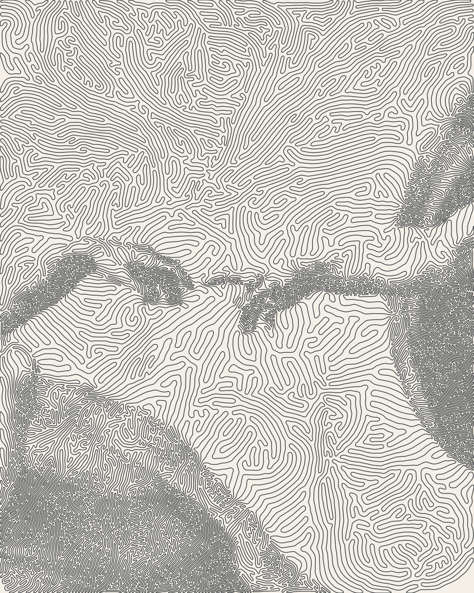
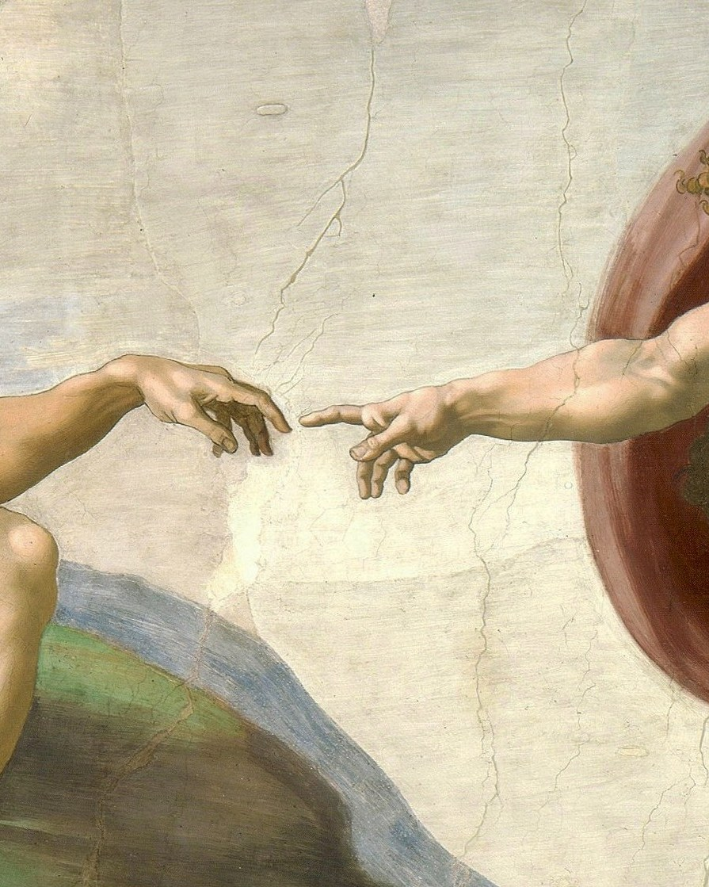
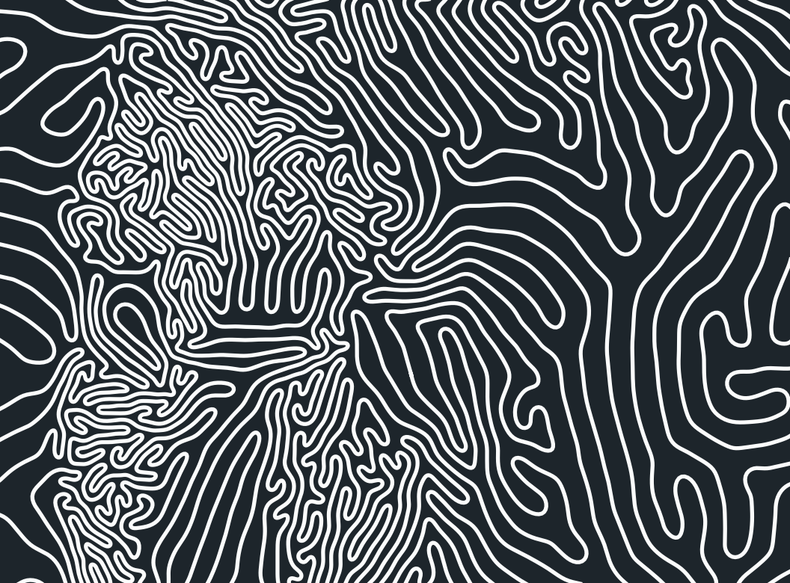
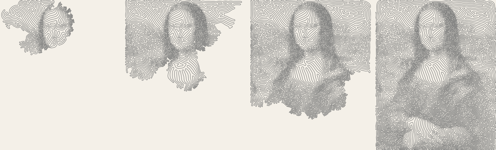
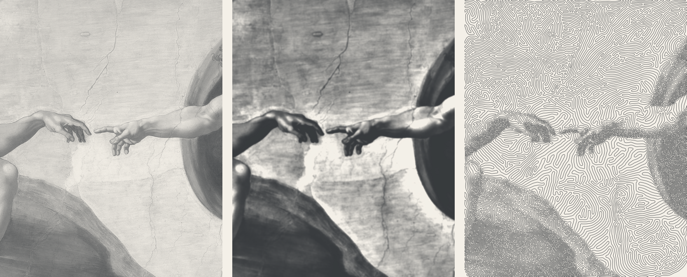

# ➰ Unbroken Line

Five paintings, each drawn by **one line**. It starts as a small ring, grows,
folds on itself and fills the frame without ever crossing: packed tight where
the painting is dark, loose where it is light, until the picture appears in
the gaps. Start anywhere on it and you can follow it all the way round and
come back to where you began.

A reactive [marimo](https://marimo.io/) notebook opens on a painting growing
under a slider, lets you tune it and grow it again (or your own picture), and
then takes the method apart one idea at a time, in plain words, with sliders.
A small script turns the growth into a video.

$$
r(\mathbf x) = r_{\min} + (r_{\max} - r_{\min})\,T(\mathbf x)^{\gamma}
$$

<p align="center">
  
  
</p>

<p align="center">
  <a href="https://monex00.github.io/unbroken-line/"><b>Open the notebook in your browser</b></a>
  &nbsp;·&nbsp; nothing to install, it runs on Pyodide
</p>

<p align="center">
  
  
  
  
</p>

Up close it is a labyrinth. Each strand below is the same line, a few pixels
from the next one, and none of them ever touch:

<p align="center">
  
</p>

## Run it

```bash
uv run marimo edit unbroken_line.py
```

Pick a painting and drag the slider to watch it grow (three of them are grown
in advance and show at once), move the tone sliders, then press **grow** to
grow it again your way, or drop in your own picture. App mode, without the code
showing:

```bash
uv run marimo run unbroken_line.py
```

The notebook declares its dependencies inline (PEP 723), so it also runs in a
throwaway environment, nothing installed:

```bash
uvx marimo edit --sandbox unbroken_line.py
```

Static page that runs entirely in the browser, working sliders and no server:

```bash
uv run marimo export html-wasm unbroken_line.py -o site --mode run
```

That is what `.github/workflows/pages.yml` does on every push, and what GitHub
Pages serves. The browser has no compiled code and one core, so a whole
painting would take the best part of an hour to grow there: the page shows the
growths made in advance and the tone map, and **grow** is only offered when
the notebook runs on your computer.

## Make a video

```bash
uv run python animate.py pearl-earring                  # out/pearl-earring/growth.mp4, 1080 wide
uv run python animate.py mona-lisa --reveal             # ends on the painting, and back
uv run python animate.py mona-lisa --palette night      # light ink on dark
uv run python animate.py pearl-earring --size 2160      # sharper
uv run python animate.py --image photo.jpg --start 0.5 0.35   # your own picture
uv run python animate.py pearl-earring --gif out/pearl.gif --size 480 --fps 15
uv run python animate.py pearl-earring --still out/pearl.png  # the finished line only
```

The growth runs once and is cached in `out/`: at the default width of 600 it
takes a few minutes on a laptop, then a few more to draw the frames. The
video needs [ffmpeg](https://ffmpeg.org/) on the `PATH`.

Three things make the video look calm rather than busy. The frames are spaced
mostly by **line length**, not by step, so the picture spreads at an even pace
instead of sitting as a small blob and then rushing; an ease slows it into the
finish, and a share of steps keeps the last settling moving instead of
freezing. The whole drawing **sways** on a slow, swirling flow from the first
frame to the last, and once the growth is done the line keeps drifting on it
like a liquid. The sway is too smooth to fold the line over itself, so it
never makes two strands cross. And each frame is averaged with its neighbours
where a strand only jitters in place.

## The idea, in seven steps

The notebook goes through these slowly, with a slider for each. This is the
short version.

### 1. One line

The line is a list of points, each joined to the next by a straight piece,
the last joined back to the first. It is drawn with one pen of fixed width,
one colour, no shading. Every grey comes from how close its strands run.

It starts as a ring of 20 points. Then, over and over, every point takes a
step made of three small nudges,

$$
\mathbf p_i \;\leftarrow\; \mathbf p_i + \mathbf B_i + \mathbf F_i + \mathbf A_i
$$

and the line is tidied up.

### 2. Tremble

Every point is kicked a short distance in a random direction,
$\mathbf B_i = f_B\, D\, \mathbf z_i$ with $\mathbf z_i$ a random normal and
$D$ the distance between points. This is the engine: a thread that wobbles is
longer than a straight one, and the extra length becomes new points (step 5).
No trembling, no growth.

### 3. Smooth

Every point is pulled a little towards the midpoint of its two neighbours,

$$
\mathbf F_i = f_F \left( \tfrac12\,(\mathbf p_{i-1} + \mathbf p_{i+1}) - \mathbf p_i \right)
$$

On its own this would shrink the ring to a dot; against the trembling it
keeps the line a curve and not a scribble. More smoothing, wider meanders;
less, a ragged line that grows like coral.

### 4. Keep your distance

Every stretch of the line is pushed away by any other stretch closer than a
distance $r$ and pulled, gently, by one a little further off. With
$\rho = d / r$ the distance in units of $r$, the strength is the
Lennard-Jones curve, the textbook rule for two atoms:

$$
w(\rho) = \rho^{-12} - \rho^{-6}
$$

A steep wall of push below $\rho = 1$, a shallow dip of pull beyond it,
nothing past $\rho = 2$. Push and pull cancel at $\rho = 1$, so strands side
by side settle **exactly $r$ apart**. That $r$ is the brush.

### 5. Split and merge

Points are kept about $0.4\,r$ apart: a piece that grows longer than that
(times 1.2) is cut in two, a point that comes too close to its neighbour is
removed. Now the loop closes. Trembling makes the line longer, long pieces
split, new points push on their neighbours, the line has nowhere to go but
sideways, so it buckles and folds, each fold held $r$ from the next. When the
frame is full there is nowhere left to buckle: the number of points stops
climbing and the growth stops by itself.

<p align="center">
  
</p>

### 6. Never crossing

The original method keeps strands apart nearly always, not always. Here it is
a guarantee, three ways:

- **short steps**: no point moves more than $r/4$ in a step, nor more than
  half its shorter neighbouring piece, so it can never jump over its own
  neighbours;
- **a check after every step**: any piece that crosses another, touches it, or
  comes closer than $r_{\min}/4$ to a strand that folded back is put back
  where it was, both ends, and checked again. The line was clean before the
  step, so this always ends;
- **careful removals**: a point is not removed if the shortcut would cut
  across another strand.

The forces keep the check rare; the check makes crossing impossible. The test
suite grows lines and counts crossings on every one of them.

### 7. From paint to spacing

So far $r$ was one number. Now it is read off a picture. Each point gets a
brightness $T$ from 0 (the darkest tone) to 1 (the lightest), and the strands
there are asked to sit

$$
r(\mathbf x) = r_{\min} + (r_{\max} - r_{\min})\,T(\mathbf x)^{\gamma}
$$

apart: $r_{\min} = 2.4$ pixels in the darks, $r_{\max} = 12$ in the lights,
and $\gamma$ above 1 keeps more of the picture dense. Before that, a little
blur, so the line follows tone and not the cracks in the varnish, and some
local contrast, so an eye stays darker than the lit cheek around it.

<p align="center">
  
</p>

A pen of fixed width can only reach about half black, where strands run side
by side, so the darks are never solid: the lights do the talking. On the dark
**night** palette the ink is light, so the map is turned over and the strands
pack where the painting is bright.

## Differences from the paper

The method is the one of Pedersen and Singh (below). These are the changes,
each made because the original came apart at these sizes:

- lengths are in units of the local spacing $r$, and points sit at most
  $0.8\,r_{\min}$ apart, so the open loops in the lights stay curves rather
  than polygons;
- two pieces of line use the **smaller** of their two spacings; with each
  point's own, where dark meets light the pushes are not mutual and dark
  strands creep into the light like the teeth of a comb;
- a point feels only the parts of the line that have folded back towards it
  (closer in space than 0.9 times their distance along the line), never the
  stretch it sits on;
- the push stops growing below $\rho = 0.85$, or the steep curve makes the
  step overshoot and the points rattle;
- short steps and the check of step 6;
- at drawing time only, ten passes of smoothing remove the point-to-point
  wobble the trembling leaves; the folds, many points wide, are untouched.

## Files

| file                       | what it does                                                                 |
| -------------------------- | ---------------------------------------------------------------------------- |
| `unbroken_line.py`         | the marimo notebook: the growth (`step`, `grow`), the drawing (`draw`), the explanation and the sliders |
| `notebook.css`             | the notebook's ink-on-paper theme                                            |
| `unbroken_line_classic.py` | the same notebook without `notebook.css`: marimo's own look                  |
| `animate.py`               | growth videos (mp4 or GIF) and stills of any painting or picture             |
| `figures.py`               | the pictures in this README and the growths the notebook shows at once, from the growths `animate.py` cached |
| `public/artworks.toml`     | the paintings: credit, crop, where the ring starts, palette, tone settings   |
| `public/art/`              | the paintings, 4:5 crops of the Commons scans                                |
| `public/growth/`           | three growths at 24 moments each, packed small (`pack_growth`)               |
| `tests/`                   | the claims, checked on grown lines                                           |

The published page is the ink-on-paper notebook; the plain version is next to
it under [`/classic/`](https://monex00.github.io/unbroken-line/classic/), and
runs the same way locally:

```bash
uv run marimo edit unbroken_line_classic.py
```

The algorithm lives in the notebook and nowhere else. Its functions sit in
marimo's `@app.function` cells, so the notebook is also an ordinary module:
`animate.py`, `figures.py` and the tests just `from unbroken_line import ...`.
Every knob of the growth is a field of one dataclass, `Growth`; a painting
changes only the ones listed under its name in `public/artworks.toml`. The hot
loops (the push and pull, the crossing check) are compiled with numba on a
uniform grid; the same code in plain numpy is kept beside them, runs in the
browser, and is the yardstick the tests hold the fast version to.

To regenerate the pictures above:

```bash
for s in pearl-earring mona-lisa creation-of-adam; do
  uv run python animate.py $s --still public/line/$s.png
done
uv run python figures.py
```

## Verified

```bash
uv run pytest
```

| check                                               | expected                       |
| --------------------------------------------------- | ------------------------------ |
| crossings or near-touches on every grown line       | none                           |
| the count of points on a blank square               | stops growing by itself        |
| strand spacing on a blank square, $r = 3$           | $r$, within 15%                |
| spacing on a two-tone square, $r = 2$ and $r = 4$   | each half its own $r$, within 15% |
| same seed, same arguments                           | the same line, byte for byte   |
| compiled kernels against the plain numpy ones       | equal to $10^{-9}$             |
| the crossing detector on a figure eight             | finds the crossing             |

## Credits

The growth is the labyrinth model of H. Pedersen and K. Singh,
[*Organic Labyrinths and Mazes*](https://www.dgp.toronto.edu/~karan/artexhibit/mazes.pdf),
NPAR 2006, with the changes listed above.

The paintings are public domain; the images are scans from Wikimedia Commons,
cropped to 4:5 and scaled down.

| painting                  | artist           | year         | collection                      | source |
| ------------------------- | ---------------- | ------------ | ------------------------------- | ------ |
| Girl with a Pearl Earring | Johannes Vermeer | c. 1665      | Mauritshuis, The Hague          | [Commons](https://commons.wikimedia.org/wiki/File:1665_Girl_with_a_Pearl_Earring.jpg) |
| Mona Lisa                 | Leonardo da Vinci | c. 1503-1519 | Louvre, Paris                  | [Commons](https://commons.wikimedia.org/wiki/File:Mona_Lisa,_by_Leonardo_da_Vinci,_from_C2RMF_retouched.jpg) |
| Lady with an Ermine       | Leonardo da Vinci | c. 1489-1491 | Czartoryski Museum, Krakow     | [Commons](https://commons.wikimedia.org/wiki/File:Lady_with_an_Ermine_-_Leonardo_da_Vinci_-_Google_Art_Project.jpg) |
| Medusa                    | Caravaggio       | 1597         | Uffizi, Florence                | [Commons](https://commons.wikimedia.org/wiki/File:Caravaggio_-_Medusa_-_Google_Art_Project.jpg) |
| The Creation of Adam      | Michelangelo     | c. 1512      | Sistine Chapel, Vatican City    | [Commons](https://commons.wikimedia.org/wiki/File:Michelangelo_-_Creation_of_Adam_(cropped).jpg) |

Works held by Italian state museums (here, Medusa) fall under the Codice dei
beni culturali, articles 107-108: reproducing them for profit needs the
museum's permission. Everything here is non-commercial.

## License

Code: MIT, see [LICENSE](LICENSE). Paintings: public domain.
